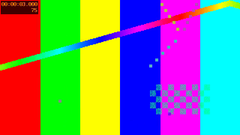
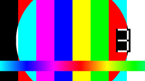
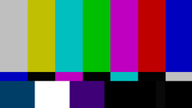
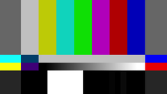
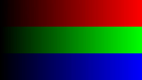
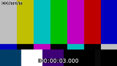
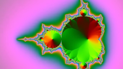

# Generated assets (ffmpeg presets)

Instead of pointing an asset at a video file, a franken-ts playlist can have an
asset **generated** by ffmpeg: a test pattern or solid colour, with a tone or
silence, rendered once and cached. Handy for building a loop (and its ad breaks)
without any source media, or for checking where a join or SCTE-35 marker lands.

```yaml
assets:
  - id: content1
    generator: {duration: 60s, preset: testsrc2, timecode: true, label: "CONTENT"}
  - id: ad1
    generator: {duration: 15s, preset: color, color: red, audio: silence, label: "AD"}
markers:
  - {event_id: 1, type: ad, splice_type: splice_insert, assets: [ad1]}
```

An asset has exactly one of `file` or `generator`. In Igor, use the **Source**
toggle on the asset (File / Generated). Reference: [`franken-ts/AGENTS.md`](../franken-ts/AGENTS.md),
"`assets`".

## Options

| Key | Default | Meaning |
|---|---|---|
| `duration` | required | Length of the clip (`30s`, `90`, `1 min 30 sec`). |
| `preset` | `testsrc2` | Video pattern, from the list below. |
| `color` | `gray` | Fill colour for the `color` preset ([colour names](https://ffmpeg.org/ffmpeg-utils.html#Color) or `#RRGGBB`). |
| `video` | none | Raw ffmpeg video source; overrides `preset` (see [Raw sources](#raw-sources)). |
| `audio` | 440 Hz sine | Raw ffmpeg audio source, or `silence`. |
| `timecode` | `false` | Burn a running `hh:mm:ss.mmm` into the video. |
| `label` | none | Text burned into the top-left corner. |

Size, framerate, GOP and H.264 profile are **not** set here: they come from the
playlist's `output`, so generated clips always match the rest of the loop. In a
ladder they render at the top-level `output.resolution` and each rendition scales
from that. Clips are cached under `<cache-dir>/generated/` (keyed by the
generator settings plus those output values); `--no-cache` re-renders.

## Presets

Frames taken 3 seconds into a clip.

| Preview | Preset | What it is |
|---|---|---|
|  | `testsrc2` (default) | Colour bars, a moving gradient sweep and a changing checkerboard, with a built-in timer and frame counter. Lots of motion, so the best default for spotting freezes, dropped frames and encoder problems. |
|  | `testsrc` | The classic ffmpeg test card: a colour gradient with a rotating marker and a running timestamp. Calmer than `testsrc2`. |
|  | `smptebars` | SMPTE colour bars. Static, so it compresses to almost nothing; good for checking colour handling and for a look that is clearly different from the content. |
|  | `smptehdbars` | The HD variant (SMPTE RP 219) of the colour bars, with extra patches and a different bottom row. Also static. |
|  | `rgbtestsrc` | Red, green and blue bands, for spotting swapped colour channels. |
|  | `color` | A solid fill (`color: red` here). The obvious choice for an ad: easy to see in a player, and cheap to encode. |

## Overlays and raw sources

| Preview | Setting | What it does |
|---|---|---|
|  | `preset: smptebars`, `timecode: true`, `label: "CONTENT"` | The timecode is the time within the generated clip, so it makes joins and ad boundaries visible: a clip that restarts at `00:00:00.000` marks where one asset ends and the next begins. |
|  | `video: "mandelbrot"` | Any ffmpeg video source can be used raw. Size and rate are added for you unless you give them. |
|  | `video: "gradients=speed=0.02"` | Another raw source, with its own options. |

Other video sources worth trying: `life`, `cellauto`, `sierpinski`, `mptestsrc`.
For audio: `sine=frequency=1000`, `anoisesrc`, or `silence`.

The full list and every option is in ffmpeg's own documentation:

- [Video sources](https://ffmpeg.org/ffmpeg-filters.html#Video-Sources)
- [Audio sources](https://ffmpeg.org/ffmpeg-filters.html#Audio-Sources)
- [`drawtext`](https://ffmpeg.org/ffmpeg-filters.html#drawtext-1) (used for `timecode` and `label`)

To list what your own ffmpeg build supports: `ffmpeg -hide_banner -filters`
(sources are shown as `|->V` or `|->A`), then `ffmpeg -h filter=<name>`.
